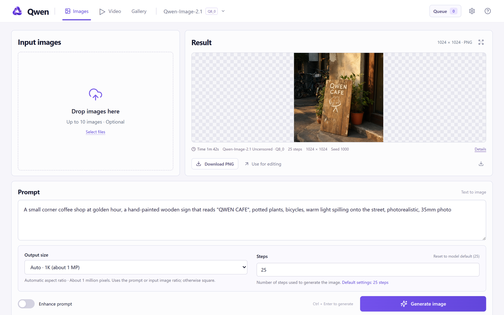
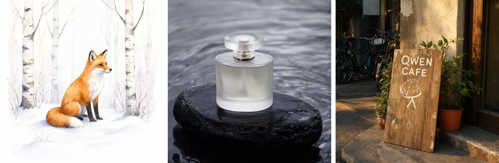
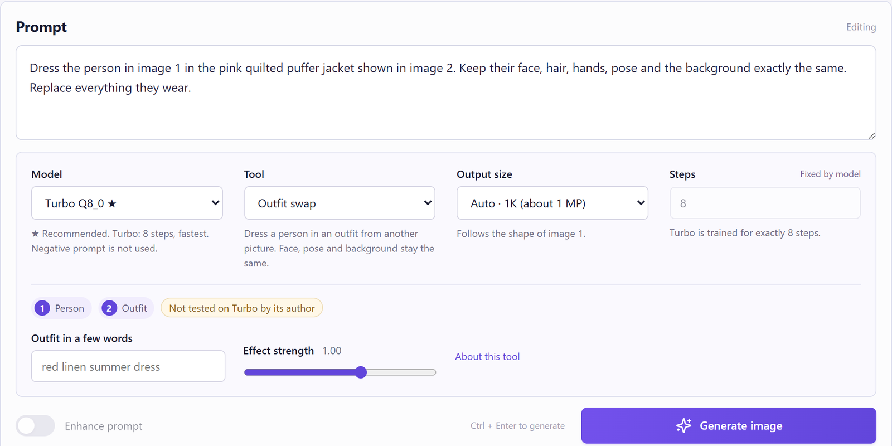
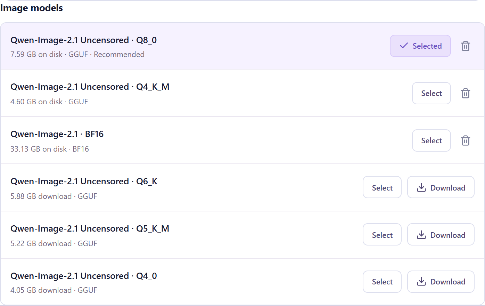
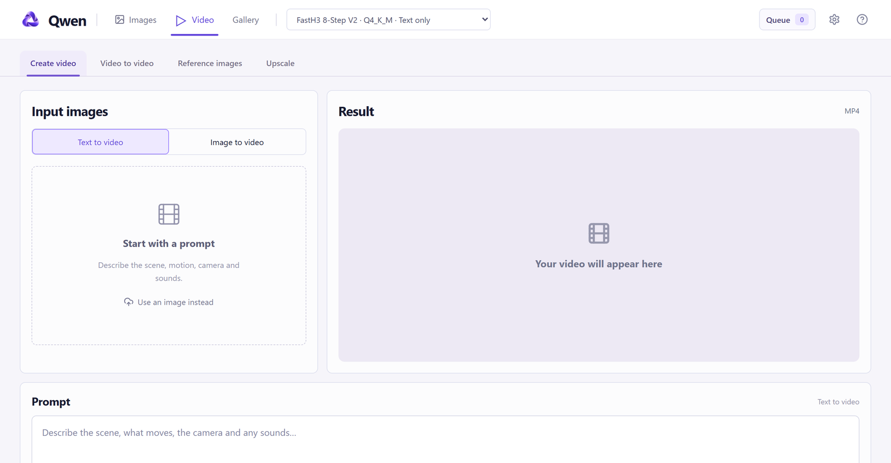
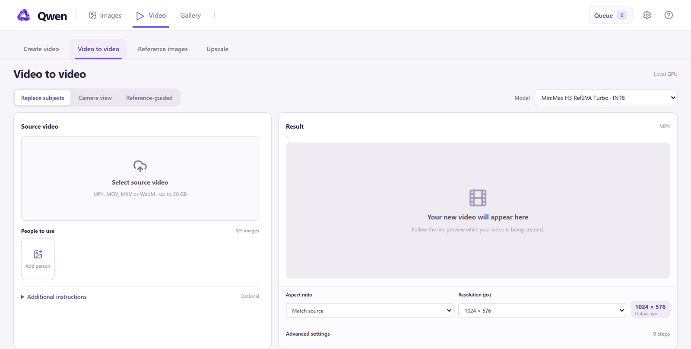
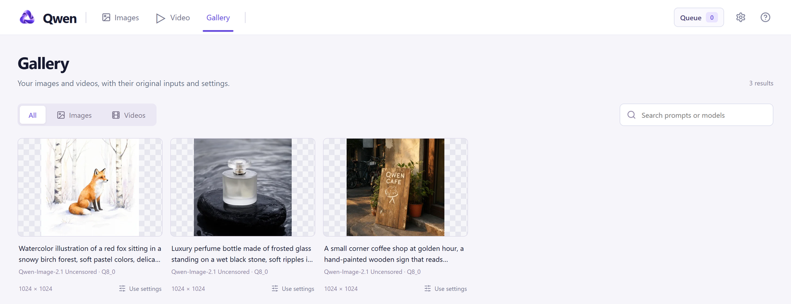

<div align="center">


# Qwen - Images & Video

**Create and edit images and videos on your own computer.**
One double-click to install. No API keys, no subscription, no cloud required.




<sub>Made locally with the Q8_0 model, prompt enhancement off.</sub>

</div>

## What it does

- **Create images** from a prompt with Qwen-Image-2.1, Krea 2 or Z-Image. Qwen-Image-2.1 writes clear text inside images, too.
- **Edit images**: add up to 10 images, then describe the change.
- **Turbo models**: the official 8-step Qwen-Image-2.1 Turbo, about 3 times faster.
- **Tools**: outfit swap, photo restore, expand image, new camera angle, remove object and character swap.
- **Civitai**: browse civitai.red inside the app and add LoRAs and models in one click. The app reads each model's own steps, CFG, sampler and VAE from its page.
- **LoRAs**: stack up to 4 LoRAs on an image or a video, each with its own strength.
- **Train LoRAs**: teach a model a person, a character or a style from your images, on your GPU.
- **People**: named avatars with photos, for quick selection as input images. Import your contacts from Moise in one click.
- **Create videos** from a prompt or from a first and last frame.
- **Change videos**: replace people, change the camera angle, or build a new scene from reference images.
- **Upscale videos** to a higher resolution.
- **Queue, recent results and gallery**: add many jobs, keep working, and find every result with its settings later.

Everything runs on your NVIDIA graphics card. Your images and videos stay on your computer.

## Requirements

- **Windows** 10 or 11
- **NVIDIA graphics card** with a current driver (tested on an RTX 4090 and an RTX 5090)
- **40 GB of free disk space** for images, more for video models

## Install

1. Download the app:
   ```
   git clone https://github.com/Ido108/qwen.git
   ```
   No Git? Click **Code → Download ZIP** on this page and unzip it.
2. Double-click **`Start Qwen.bat`**.
3. Choose where Qwen keeps its files. Press **Enter** for drive C, or type another drive letter, for example `D`.

The first start installs everything automatically and takes about **20 minutes**. Most of this time is the download of the graphics libraries (several GB). You do not need to install Python or anything else, and you do not need administrator rights.

When the installation is done, Qwen opens in its own window. To open it later, double-click **`Start Qwen.bat`** again, or the **Qwen** shortcut next to the app folder. Later starts take a few seconds.

## Create your first image

1. Write a prompt, for example: `A small coffee shop with a wooden sign that reads "QWEN CAFE"`.
2. Click **Generate image**.

The first image also downloads the model (about 18 GB). A small download indicator at the bottom left shows the progress, speed and time left on every page, and the download continues when you switch pages. After that, a 1K image takes about 20 seconds with a standard model and about 6 seconds with Turbo (RTX 5090, model already loaded).

When the queue is idle, Qwen loads the last image model you used in the background, also after a video job. So the next image starts in about 2 seconds instead of about 45.

To **edit** an image, add it to **Input images** and describe the change, for example `Make it a rainy night with neon reflections`. Ways to add an image:

- Drag it in, or click **Select files**.
- Press **Ctrl + V** anywhere on the page to paste a copied image.
- Open the library and check images in **Uploads**, **Results** or **People**. The number on a checkmark is the input position.
- Click **Use as input** on a result in the **Recent** panel, or **Use for editing** under the result.

Click an input image to replace it: the library opens, and the image you pick (or upload) takes its place. Click **+** or **Library** to add images instead. The small zoom button on an input image opens it large.

**People.** Each person has a round face avatar, a name and one or more photos. Click an avatar to add the person's main photo. Click the small photo count under the name to choose another photo of that person, or to make a photo the main one. **New** makes a person from the checked images. **Moise** imports your contacts and their photos from your Moise assistant (the first import asks Railway for the password once and keeps it encrypted).

**Prompt history.** The clock button next to the prompt lists your earlier prompts. Click a line to load it, or click the play button to run it again. Every prompt tab has its own history.

Turn on **Compare** above the result to slide between the input and the result.

> **Tip:** For a transparent background, open **How to use** (the **?** icon) and click **Use transparent image prompt**.

## Model, tool, size and steps

All image settings are in one row under the prompt.



**Model.** Choose a standard model or a Turbo model. A model that is not downloaded yet shows its size; it downloads when you generate.

| Image model | Size | Steps | Choose it when |
| --- | --- | --- | --- |
| **Standard Q8_0** | 7.6 GB | 25 | You want the best quality. Recommended. |
| Standard Q6_K / Q5_K_M | 5.9 / 5.2 GB | 25 | You want a smaller download. |
| Standard Q4_K_M / Q4_0 | 4.6 / 4.1 GB | 25 | Your graphics card has less memory. |
| Standard BF16 | 14.2 GB | 25 | You want the original full-precision model. |
| **Turbo Q8_0** | 7.6 GB | 8 | You want speed. Recommended Turbo. |
| Turbo Q6_K / Q5_K_M / Q4_K_M | 5.9 / 4.9 / 4.1 GB | 8 | You want a smaller Turbo. |
| Turbo BF16 | 14.2 GB | 8 | You want the original full-precision Turbo. |

All Qwen image models share one text encoder and VAE (about 10 GB, downloaded once).

**Krea 2.** The Model list also has **Krea 2 Turbo** (8 steps, fast) and **Krea 2 Raw** (52 steps, CFG 4.5, best detail up to 1K). They use their own text encoder and VAE, which download the first time. The app sets the official steps, CFG, sampler and schedule when you pick a Krea model. Krea 2 cannot edit images or keep a person: input images go through the official Style Reference LoRA, which copies colors, light and clothing style only. The Input images panel says so when a Krea model is chosen. Qwen tools and Qwen LoRAs do not work with Krea, and the app says so.

**Z-Image.** The Model list also has **Z-Image Turbo** (8 steps, CFG 1, fast) and **Z-Image Base** (30 steps, CFG 4, negative prompt works), from the official Comfy-Org files. They use their own text encoder (Qwen3 4B) and VAE (Flux ae), which download the first time. The app uses the official ComfyUI settings: res_multistep, simple, shift 3. Z-Image has no edit model (Tongyi has not released Z-Image-Edit). With an input image it redraws image 1 (image to image): the result keeps the layout, pose and colors and follows the prompt for the rest. **Change** sets how much is redrawn (default 70%; low keeps more of the image, 100% ignores it). Z-Image uses one input image and does not keep a face exactly. To edit a photo or keep a face, choose a Qwen-Image-2.1 model. Qwen tools and Qwen or Krea LoRAs do not work with Z-Image.

**Steps and CFG** start at the model's own values: 25 steps for standard models, 8 for Turbo, and for a Civitai model the values its page asks for. You can type other values, and **Reset** returns to the model's value. Turbo is trained for 8 steps; another count follows the same schedule, stretched to the new length. A CFG above 1 runs a second guidance pass, so each step takes about twice as long.

**Tool.** A tool adds a small add-on model (LoRA, 80 to 320 MB) and writes the right prompt for you. The input chips show which picture goes where.

| Tool | Inputs | What it does |
| --- | --- | --- |
| **Outfit swap** | 1 person, 2 outfit | Dresses the person in the outfit. Face, pose and background stay the same. |
| **Restore photo** | 1 photo | Removes blur, noise, compression artifacts or old-print damage, and enlarges it. |
| **Expand image** | 1 image | Extends the picture to the sides you choose. The original part stays unchanged. |
| **New camera angle** | 1 subject | Shows the subject from another side or height. |
| **Remove object** (experimental) | 1 image | Click **Mark object**, draw a box around the object, then generate. |
| **Character swap** (experimental, Turbo only) | 1 scene, 2 character | Puts the character from picture 2 into picture 1. Results vary. |

Every tool has an **Effect strength** slider.

**Output size.** One list: **Auto 1K**, **Auto 2K**, the fixed sizes, and **Custom…** for any width and height.

**Advanced settings** has the seed, the negative prompt, the output folder, and **Image decoder (VAE)**. **Random seed** is on by default, also after you load the settings of an earlier result. The VAE is **Auto** by default: the VAE the model's page names or ships, otherwise **Texture fix**, which decodes the same images with fewer checkerboard artifacts.

**LoRAs.** Click **Add LoRA** to stack up to 4 LoRAs on any image model, each with its own strength. A LoRA's trigger words go into the prompt for you. Find more LoRAs in the **Civitai** tab.

## Civitai

Open the **Civitai** tab to browse [civitai.red](https://civitai.red) for **Images** (Qwen-Image-2.1, Krea 2 and Z-Image) or **Video** (MiniMax H3 and LTX 2.5), **LoRAs** or **Models**. Only files that run in this app are listed. Search by name, creator or tag, filter by architecture (Qwen-Image 2.1, Krea 2 or Z-Image; MiniMax H3 or LTX 2.5) and models by **Standard** (Raw for Krea 2, Base for Z-Image) or **Turbo**, or paste a Civitai link. The type comes from the base model tag, the version name, or the page's settings (CFG 1 or 10 steps and fewer is Turbo). When none of these tells, the card says **Type not stated**, the filters leave it out, and the dialog asks you to choose. The app keeps a full list of these models on your computer for 6 hours, so a search covers everything and answers at once (the first list builds in the background after the app starts).

Open a card to see every version on the page. For each version the app shows its type, the file format and size, and the steps, CFG, sampler and scheduler: the page's values are marked "from the page", the rest are the defaults. It reads settings lists ("Sampler: Euler A + BETA", "Steps: 8") and the example images too. When a page lists settings for several architectures ("SDXL Usage", "ZIT Usage"), the app uses the list for the version's own architecture. Click **Add to Qwen**. Several models can download at the same time, each with its own progress and Cancel. A download uses 8 parallel connections and continues if you close the dialog. If Civitai refuses a file (for example Early Access), the app shows Civitai's reason. The account shows as connected only while Civitai accepts it. If you cancel, **Add to Qwen** later continues from where it stopped.

The app checks every file before it uses it: the checksum and the shape of the model, so a file for another model type is refused.

LTX 2.5 checkpoints come in two kinds. A **distilled** checkpoint runs as it is. A **dev** checkpoint gets the official Lightricks distilled LoRA (8.9 GB, downloaded once) at strength 0.5, as the model pages describe, and then runs the same 8-step schedule. When a page does not say which kind it is, the app does not offer it, because the wrong kind makes broken video. **Connect Civitai account** is needed only for files that require a signed-in account.

## Train a LoRA

Open the **Train** tab to make your own LoRA from your images: a person, a character or a style. It uses [ai-toolkit](https://github.com/ostris/ai-toolkit) by Ostris with the settings of its own UI for each model.

1. **Install the trainer** once (about 9 GB in the app's runtime folder: ai-toolkit and its own PyTorch). Your models and images are not changed.
2. Enter a **Name**, choose the **Base model** (Qwen-Image-2.1, Qwen-Image-2.1 Turbo, Krea 2 Raw, Krea 2 Turbo, Z-Image Turbo or Z-Image Base) and a **Trigger word**: a rare word that calls the LoRA in a prompt.
3. Add 15 to 40 images from the library (uploads, results, People) or upload them. For a person, use sharp images with different clothes, places, light and angles.
4. Click **Write captions with Antigravity**, then check them. For a person the captions describe clothes, place and pose, not the face: the trigger word learns the face. You can also write them yourself.
5. Click **Start training**. The training is a queue job, so image and video jobs wait until it ends. The card shows the step, the loss, the time left and sample images at every save.

The first training of each base model downloads it (Z-Image Turbo about 25 GB). Krea 2 needs access on its Hugging Face page with the account on this computer. Turbo models train with the official training adapter, so the LoRA keeps Turbo fast. A LoRA works with the models of the type it was trained on, also Civitai models of that type: a test LoRA trained on Z-Image Turbo did nothing on Z-Image Base. When the training ends, the LoRA is in the LoRA list. **Use this LoRA** opens Images with the LoRA and a model it works with.

**Stop** ends the training and keeps the saved steps. **Continue** (or a new training with the same name and base model) starts from the last saved step. Settings: steps (auto: about 100 per image, 1000 to 3000), rank, learning rate, image sizes and sample prompts. Qwen-Image-2.1 LoRAs made with ai-toolkit (here or on Civitai) train one fused MLP layer; the app splits it into the two layers the model uses, so the whole LoRA applies.

## Settings

Open **Settings** (the gear icon). It has three tabs:

- **Models**: download or remove any model, tool or video model. Removing a model does not delete your images or videos.
- **Google account**: writes training captions on the Train tab.
- **Processing**: run on this computer or on a RunPod cloud GPU.



## Google account (optional)

The Train tab can write the captions of your training images with Gemini through your Google account (no API key). Open **Settings** and click **Connect Google Account**. Only the training images you caption go to Google. The app sends your prompts to the model exactly as you write them.

## Video

Open the **Video** tab. It has four workflows:

<table>
<tr>
<td width="50%"><b>Create video</b>: write a prompt, or add a first and last frame. Choose the duration and size, then click <b>Generate video</b>.</td>
<td width="50%"><b>Video to video</b>: replace people in a clip, change the camera view, or edit it with reference images.</td>
</tr>
<tr>
<td></td>
<td></td>
</tr>
<tr>
<td><b>Reference images</b>: create a new scene from up to four photos of people or objects and an optional background.</td>
<td><b>Upscale</b>: increase the resolution of a video and keep its sound.</td>
</tr>
</table>

Every video result has **Send to**, which opens it in another workflow. For example, create a video and then upscale it.

Each workflow lists every model that can do its task, grouped by family, with what it supports:

| Workflow | Models |
| --- | --- |
| Create video | MiniMax H3 and FastH3 (text, first and last frame), LTX 2.5 (text, first frame, first and last frame) |
| Video to video | MiniMax H3 Ref2VA |
| Reference images | LTX 2.5 with the multi-reference add-on, MiniMax H3 Ref2VA (images only) |
| Upscale | SeedVR2, FlashVSR, SwiftVR |

Picking a model sets its own frame counts, sizes and steps. Video LoRAs show only for the models they fit.

Video models are large (4 to 20 GB each). Each one downloads the first time you use it.

> **Reference images** uses LTX 2.5. Its files require access to the [Lightricks model](https://huggingface.co/Lightricks/LTX-2.5) on Hugging Face. Accept the terms there, then set the `HF_TOKEN` environment variable to a token of that account.

## Queue and gallery



- Click **Generate** as many times as you want. Each click adds a job to the **Queue**, and you can keep working.
- On the Images page, the last finished image stays in **Result**. Running and waiting jobs show beside it with their progress, also when Recent is hidden. Each image that finishes appears in Result by itself.
- In **Queue**, **Stop** ends the job that runs now, **Remove** takes one waiting job out, and **Remove all waiting** clears the line. You can also move jobs up or pause the queue. Waiting jobs stay saved when you close the app. The button next to **Generate** says what it does: **Stop this job** while your job runs, **Remove from queue** while it waits.
- **Recent** (the panel on the right of the Images page) shows your latest results and the running jobs. Hover a result to use it as input or to load its settings. Click **>>** to hide the panel.
- **Delete results** in the **Gallery**: hover a result and click its circle to check it, or click **Select all**. **Delete** removes the checked results and their files from your computer. Running and waiting jobs are never deleted.
- **Gallery** shows all your images and videos. Open one, then press **←** and **→** to browse. Turn on **Compare with input** to slide between the input and the result. **Use settings** loads the prompt and settings of a result. **Run again** makes a new version.

## Other tools

These are in the `scripts` folder:

| File | What it does |
| --- | --- |
| `Restart Qwen.bat` | Closes Qwen and opens it again. |
| `Show Qwen Logs.bat` | Shows what Qwen is doing. Use it when something goes wrong. |
| `Download Models.bat` | Downloads the recommended image models without opening the app. |

To close Qwen, close its window.

## Swap (head or body)

**Images > Swap** puts the head or the whole person from one picture into another, with the BFS LoRAs for Qwen-Image-2.1 (Alissonerdx/BFS-Best-Face-Swap, MIT). The LoRA downloads on first use.

1. Choose **Head swap**, **Head swap, stronger expression** (copies an open mouth or strong expression more fully) or **Body swap** (face, clothing and body shape).
2. Picture 1 is the scene: its body or pose, expression, light and background stay. Picture 2 gives the head or the person. Upload, or pick from the library or People.
3. Click **Generate image**. The result has the shape of picture 1, at about 2 MP.

The app feeds the pictures as the author does: both at about 2 MP for a head swap; for a body swap the person at about 0.59 MP. Body swap works best when picture 2 shows the person full body, facing the camera, on a plain light background. Effect strength 1.0 is the author's setting. Use it only with pictures of people who agreed.

## Remote use (phone)

While Qwen runs on the PC, it also connects to the Moise server, and the whole app opens at `<Moise address>/qwen-studio/` (link in the Moise dashboard). Everything works there: images, inputs from the phone, video, Civitai, training and the queue. The PC opens no ports: Qwen keeps an outbound connection to Moise, and Moise asks for the dashboard login.

- Settings (Windows user environment variables, the same as for MoiseGpuServer): `MOISE_SERVER_URL` (https) and `MOISE_RELAY_TOKEN` (the Moise dashboard key). Without them, Qwen runs only locally.
- One Qwen at a time can be connected. `QWEN_REMOTE=0` turns the connection off for a copy.
- An upload through the remote page can be at most 200 MB.

If the Qwen window closes because the computer ran out of memory, Qwen and its jobs keep running and the window opens again. Closing the window yourself still stops Qwen.

## Troubleshooting

| Problem | Solution |
| --- | --- |
| The installation stopped | Double-click `Start Qwen.bat` again. It continues from where it stopped. |
| "NVIDIA CUDA is unavailable" | Update your NVIDIA driver, restart Windows, then start Qwen again. |
| Generation is very slow | Close other programs that use the graphics card, or choose a smaller model (Q4_K_M). |
| Out of memory | Choose **Auto 1K** or a smaller model. |
| "Connect the drive containing ..." | Connect the drive you chose during installation. |

## Uninstall

1. Delete the app folder.
2. Delete the data folder that you chose during installation (by default `C:\AI\qwen-image-studio`).

## Mac

On a Mac, open `quickStart.command`. Generation runs on a RunPod cloud GPU instead of your computer. See [RUNPOD.md](RUNPOD.md).

## License

The Qwen models and code are under the [Qwen Research License](reference/Qwen-Research-LICENSE.txt). Other models have their own licenses on their Hugging Face pages. Third-party code licenses are in the `vendor` folder.
